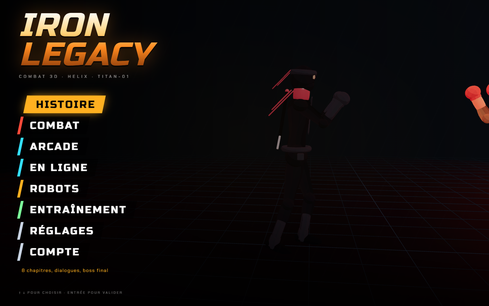
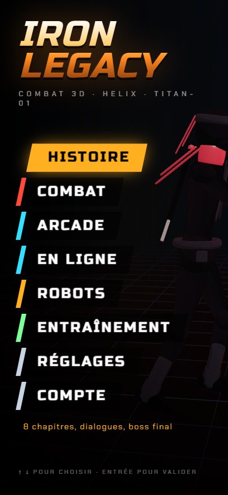

# Iron Legacy · Le jeu de combat 3D dans le navigateur

🌐 **[iron.projectp.fr](https://iron.projectp.fr/)** · Jour 28 du défi **[30 jours, 30 projets](https://projectp.fr/)** · [Dépôt du défi](https://github.com/PierreWZK/30DaysProjects)

Stack : TypeScript, React Three Fiber, Colyseus. Projet provisoire « PROJECT IRON LEGACY ».

[](https://iron.projectp.fr/)

<p align="center">
  
</p>

```bash
npm install
npm run dev        # client sur http://localhost:5328
npm test           # tests du moteur de combat
npm run typecheck
npm run build
```

Voir [docs/ARCHITECTURE.md](docs/ARCHITECTURE.md) pour l'architecture et [CLAUDE_CONTEXTE.md](CLAUDE_CONTEXTE.md) pour l'avancement.

---

## Le défi 30 jours, 30 projets

Un projet complet par jour pendant 30 jours, chacun en ligne sur son propre sous-domaine.

- 🗂️ **Tous les projets** : [projectp.fr](https://projectp.fr/)
- 💻 **Le dépôt du défi** : [github.com/PierreWZK/30DaysProjects](https://github.com/PierreWZK/30DaysProjects)
- ⬅️ **Jour précédent** : [Tournée, carte bars et trajet](https://tournee.projectp.fr/)
- ➡️ **Jour suivant** : [LayR, design de sites web](https://layr.projectp.fr/)
